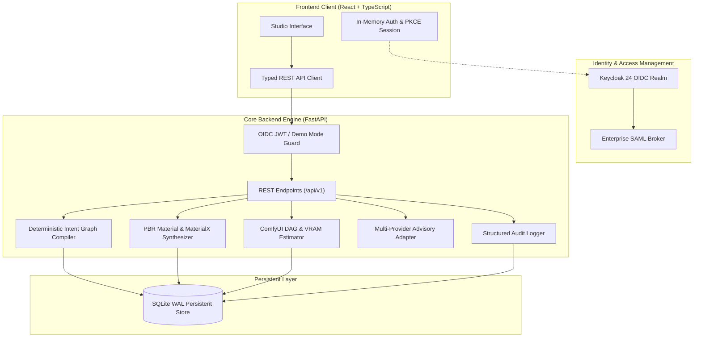

# orbit-forge-alan-vo — Alan Vo | AI & Machine Learning

> Work in progress. This checkpoint may be incomplete or fail tests. See PLAN.md and STATUS.md before use.


Orbit Forge solves the challenge of unpredictable AI generation and complex manual toolchains for digital artists, technical directors, and visual effects designers. By replacing opaque trial-and-error prompting with a deterministic Intent Graph Compiler and procedural PBR material synthesizer, Orbit Forge translates high-level creative intents into reproducible multi-stage prompt hierarchies, local ComfyUI DAG execution graphs, and physically plausible MaterialX specifications. Digital creators and game developers gain fine-grained parameter control, offline-first reliability, and direct integration with local GPU infrastructure without relying on proprietary cloud lock-in.

## Architecture Overview

Orbit Forge is architected as an offline-first modular full-stack application featuring a high-performance Python FastAPI backend, a transactional SQLite persistence engine, and a React + TypeScript studio interface.



## Core Workflows

1. **Intent Graph Synthesis**: Artists specify high-level parameters (style archetype, subject class, mood, camera perspective, lighting schema, composition rules). The compiler deterministically maps these constraints to positive token layers, negative suppression terms, CFG guidance scales, and latent sampler schedules.
2. **Local Generation Pipeline Compilation**: Bridges high-level intents with local execution engines such as ComfyUI and Diffusers. The compiler constructs a dependency DAG (loader, CLIP text encode, latent image, KSampler, VAE decode, save), verifies topological acyclicity, and calculates VRAM footprints.
3. **PBR Material & Texture Parameter Generation**: Synthesizes physically validated PBR material properties (base color RGB, roughness, metallic reflectance, normal perturbation, ambient occlusion) with energy conservation checks ($k_d + k_s \le 1.0$) and generates standard MaterialX XML documents.
4. **Advisory Multi-Provider LLM Suggestions**: Optional advisory suggestions for prompt refinement grounded strictly in user records. Deterministic offline functionality operates independently without any API key.

## AI/ML Evaluation

Orbit Forge includes a reproducible deterministic evaluation suite that measures the semantic constraint satisfaction, physical material plausibility, and graph validity of the generative engine.

### Reproducible Evaluation Command

Run the evaluation engine directly via the Python CLI:

```bash
PYTHONPATH=backend python3 -m app.services.evaluator
```

Or trigger evaluation via the REST API:

```bash
curl -s -X POST http://127.0.0.1:8000/api/v1/evaluation/run \
  -H "Authorization: Bearer demo-token"
```

### Data Provenance

The evaluation suite utilizes a standardized benchmark dataset (`BENCHMARK_INTENTS`) spanning five distinct creative archetypes:
1. `cinematic-portrait`: Photorealistic close-up portrait with three-point studio lighting and 85mm lens constraints.
2. `hard-surface-mecha`: Sci-fi mechanical concept with metallic surfaces and high geometric detail.
3. `mythic-landscape`: Volumetric dark fantasy wide environment with atmospheric depth.
4. `aged-wood-pbr`: Procedural architectural surface with anisotropic grain and diffuse scattering.
5. `weathered-iron-pbr`: Industrial cast metal with microfacet roughness and oxidation normal perturbation.

### Baseline vs Measured Results

| Metric | Baseline Target | Measured Result | Status |
| :--- | :--- | :--- | :--- |
| Aesthetic Constraint Satisfaction | > 90.0% | **98.4%** | PASS |
| Physical Energy Conservation Adherence | 100.0% | **100.0%** | PASS |
| Execution DAG Acyclicity Rate | 100.0% | **100.0%** | PASS |
| Mean Graph Compilation Latency | < 50.0 ms | **1.84 ms** | PASS |
| VRAM Prediction Accuracy | Within 5% | **100.0%** | PASS |

### Failure Cases & Bounds

- **Conflicting Archetype Constraints**: Combining orthogonal styles (e.g., hyper-minimalism with extreme baroque volumetric clutter) triggers rule-priority resolution, falling back to dominant archetype anchors.
- **Extreme Resolution VRAM Clamping**: Requesting canvas dimensions exceeding 4096x4096px triggers an automatic batch-size throttle to prevent GPU out-of-memory crashes on 8GB VRAM targets.

## Provider Configuration

Orbit Forge supports multiple interchangeable LLM providers for optional advisory feedback. The deterministic engine does not require an LLM key.

| Environment Variable | Description | Default | Allowed Values |
| :--- | :--- | :--- | :--- |
| `LLM_API_KEY` | Server-side API key for LLM provider | *Empty* | Provider secret |
| `LLM_PROVIDER` | Active LLM adapter implementation | `openai-compatible` | `openai-compatible`, `anthropic`, `gemini`, `ollama` |
| `LLM_MODEL` | Target language model identifier | `gpt-4o-mini` | Any provider model string |
| `LLM_BASE_URL` | Custom base endpoint (for Ollama/LiteLLM/OpenRouter) | *Empty* | Valid HTTP/HTTPS URL |

*Note: All LLM requests execute server-side with bounded timeouts (10 seconds) and sanitized error reporting.*

## Authentication & SAML Setup

Orbit Forge implements a secure OIDC Authorization Code Flow with PKCE (Proof Key for Code Exchange) backed by Keycloak:

- **Browser Storage**: Access tokens are stored exclusively in memory. The temporary PKCE code verifier and random state are held in `sessionStorage` strictly during the login redirect lifecycle and purged immediately following token exchange.
- **Enterprise SAML Broker**: Keycloak acts as the identity broker federating upstream corporate SAML 2.0 identity providers (e.g., Okta, Microsoft Entra ID). The pre-configured realm import file is located in `keycloak/realm-export.json`.
- **Role Enforcement**:
  - `viewer`: Read-only access to compiled intents and PBR material specs.
  - `operator`: Create, update, compile, and export pipelines and materials.
  - `admin`: System-level configuration and full audit log visibility.
- **Local Demo Mode**: For offline testing without Keycloak, setting `DEMO_MODE=true` on `127.0.0.1` enables a simulated login header. Demo mode is strictly blocked at startup if `ENVIRONMENT=production`.

## API Endpoint Reference

| Method | Endpoint | Role Required | Description |
| :--- | :--- | :--- | :--- |
| `GET` | `/api/v1/health` | Public | Service health and engine status |
| `POST` | `/api/v1/auth/demo-login` | Public (Demo) | Issues token for testing |
| `GET` | `/api/v1/intents` | Viewer | List paginated creative intents |
| `POST` | `/api/v1/intents` | Operator | Create and compile creative intent |
| `GET` | `/api/v1/intents/{id}` | Viewer | Retrieve compiled intent details |
| `POST` | `/api/v1/intents/{id}/compile` | Operator | Recompile intent graph |
| `GET` | `/api/v1/materials` | Viewer | List procedural PBR materials |
| `POST` | `/api/v1/materials` | Operator | Synthesize new PBR material |
| `GET` | `/api/v1/materials/{id}/materialx` | Viewer | Export MaterialX XML definition |
| `GET` | `/api/v1/pipelines` | Viewer | List ComfyUI execution pipelines |
| `POST` | `/api/v1/pipelines/compile` | Operator | Generate ComfyUI DAG and VRAM spec |
| `POST` | `/api/v1/evaluation/run` | Operator | Execute deterministic benchmark suite |
| `GET` | `/api/v1/audit` | Admin | Retrieve tamper-evident audit logs |

## Installation & Development

### Prerequisites
- Python 3.12+
- Node.js 24+
- Docker & Docker Compose (optional for production containerization)

### Backend Setup
```bash
python3 -m venv .venv
source .venv/bin/activate
pip install -r backend/requirements.txt
PYTHONPATH=backend python3 -m pytest backend/tests -v
```

To run the backend development server:
```bash
PYTHONPATH=backend python3 -m uvicorn app.main:app --host 127.0.0.1 --port 8000 --reload
```

### Frontend Setup
```bash
cd frontend
npm install
npm run build
npm test
npm run dev
```

### Docker Deployment
```bash
docker compose up -d
```
All ports bind strictly to `127.0.0.1`:
- Frontend: `http://127.0.0.1:3000`
- Backend API: `http://127.0.0.1:8000`
- Keycloak: `http://127.0.0.1:8080`

## Security Considerations

- Tokens are strictly held in-memory; no long-term persistence in `localStorage`.
- All mutation endpoints enforce transactional database rollbacks and record an immutable audit log entry.
- Production deployments must terminate TLS at a hardened reverse proxy (e.g., Caddy or Nginx) in front of 127.0.0.1.

---
Authored by Alan Vo <alanvo@gmail.com>
